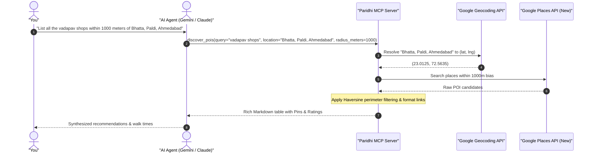

Have you ever opened a food delivery or discovery app to order lunch, only to
notice that the exact same roll, burger, or thali costs **20% to 30% more** on
the app than if you walked into the restaurant? Layer on delivery fees, platform
convenience fees, and surge charges, and a quick meal suddenly comes with a
steep aggregator premium. 🍔💸

Even worse is what happens to discovery. Searching for "best coffee" or "top
street food" rarely shows you the most authentic local spots anymore. Instead,
your feed is dominated by whoever paid the highest ad bid or signed the most
exclusive merchant deal. Meanwhile, the true hidden gems—the 30-year-old family
bakery, the corner tea stall with a 4.7-star rating, or the incredible local
bistro right down the street from your office—remain completely invisible
because they don't play the aggregator advertising game.

What if your AI assistant could act as your personal, unbiased local scout? An
agent that understands real-world geography, searches within your exact walking
or driving perimeter, and discovers authentic local spots with verified reviews
without sponsored noise or marked-up menus?

Meet [**Paridhi**](https://github.com/anshulpatel25/paridhi) (परिधि) — an
open-source [Model Context Protocol (MCP)](https://modelcontextprotocol.io/)
server that equips modern AI agents with spatial awareness to discover, filter,
and enrich local points of interest. 🚀📍

<!--more-->

<!-- markdownlint-disable-file MD013 MD060 -->

---

## 🧐 The Problem: Why Commercial Discovery Apps Let Us Down

For years, we relied on delivery and discovery apps because they solved an
undeniable logistics challenge: bringing menus and storefronts to our phones.
However, over time, the economics of these platforms shifted in ways that hurt
both consumers and neighborhood businesses:

1. **The 20%–30% "Menu Markup"**: To offset high commission rates charged by
   aggregators, restaurants routinely inflate their listed prices. When you add
   taxes, handling, and delivery charges, you are paying significantly more for
   the convenience of ordering through an intermediary.
2. **Sponsored Clutter & Algorithmic Bias**: Commercial platforms prioritize
   merchants who purchase sponsored placement or buy into premium promotion
   tiers. The first ten recommendations you see are often paid ads rather than
   the highest-quality local options.
3. **The Hidden Gem Blind Spot**: Many of the best food joints, artisan
   roasters, and cultural landmarks near our homes or workspaces do not offer
   app delivery or maintain marketing budgets. They thrive purely on word of
   mouth and genuine local reputation, making them invisible on commercial
   delivery platforms.
4. **Rigid Geofences**: Delivery apps restrict what you can see based on
   delivery fleet coverage. If a great spot is just 200 meters outside an
   arbitrary delivery zone, you never even learn that it exists.

When you are sitting at your desk or walking around a neighborhood, you don't
need a sponsored advertising feed. You need **unbiased, spatially accurate local
intelligence**.

---

## 🌐 What is Paridhi?

In Sanskrit, the word **Paridhi** (_परिधि_) translates to _perimeter_,
_circumference_, or _boundary_. That exact concept forms the foundation of this
project.

Paridhi connects your AI agents (such as Gemini, Claude, Antigravity, or Cursor)
directly to authoritative geospatial data using the Model Context Protocol.
Rather than presenting algorithmic rankings influenced by ad dollars, Paridhi
operates strictly within a defined spatial circle around your current location or
a specified neighborhood.

```goat
+-------------------------------------------------------------+
|                     Your Agentic Workspace                  |
|                                                             |
|   +-------------------+              +------------------+   |
|   |   Gemini Agent    | <---MCP----> |  Paridhi Server  |   |
|   |  (via MCP Gateway) |    (stdio)   |    (FastMCP)     |   |
|   +-------------------+              +--------+---------+   |
|                                               |             |
+-----------------------------------------------|-------------+
                                                |
                                                v
                              +-----------------------------------+
                              |       Google Maps Platform        |
                              |  - Geocoding API (Neighborhoods)  |
                              |  - Places API New (Rich Metadata) |
                              +-----------------------------------+
```

### Key Technical Highlights

- 🎯 **Strict Spatial Perimeters**: Applies haversine distance filtering to
  ensure every discovered point of interest strictly falls within your chosen
  radius.
- 🛡️ **Predictable Clamping**: Automatically bounds search radii to `[100m,
50,000m]`, preventing runaway queries or accidental massive geofences.
- 📐 **Hexagonal / Clean Architecture**: Built with a Ports & Adapters design
  that cleanly separates the domain logic from external providers. It supports
  Google Maps Platform out of the box, with built-in mock providers for fast,
  offline unit testing.
- 💰 **Billing Optimization via Field Masks**: Uses explicit Places API (New)
  field masks (`X-Goog-FieldMask`) to request only necessary attributes,
  keeping API costs minimal.
- 🔗 **Agent-Ready Markdown Output**: Automatically formats discovered places
  into rich Markdown tables with deep links to Google Maps pins and verified
  ratings.

---

## ⚙️ Architecture & Sequence Flow

When an AI agent invokes Paridhi, the server handles everything from informal
landmark resolution to spatial filtering:



---

## 🎥 Paridhi in Action: Gemini & Cloudflare MCP Gateway

To see Paridhi in action, check out the video walkthrough below where I
demonstrate using this MCP server alongside **Google Gemini**:



### Why Cloudflare MCP Gateway?

In this setup, API traffic between the agentic harness and Gemini routes
through via [_Anshul Patel Gateway_](https://gateway.anshulpatel.in/) which is actually **Cloudflare MCP Gateway**. This architecture brings several enterprise-grade
benefits to everyday agent workflows:

1. **Authentication & Authorization**: Cloudflare MCP Gateway acts as a secure
   reverse proxy, allowing you to centralize API credential management and apply
   zero-trust access policies without baking sensitive secrets into client
   runtimes.
2. **Caching & Lower Latency**: Repeated spatial lookups or intermediate agent
   reasoning steps can be cached at the Cloudflare MCP Gateway edge, reducing both latency
   and token costs.
3. **Rate Limiting & Cost Guardrails**: Autonomous agents can occasionally enter
   unintended retry loops. The MCP Gateway enforces hard rate limits and budget
   thresholds to protect against surprise API bills.
4. **Unified Observability**: Every request, prompt token, completion token,
   and latency metric is logged in a centralized dashboard, giving you complete
   visibility into how your agent interacts with tools.

---

## 🛠️ MCP Configuration & Agent Integration

Connecting Paridhi to your favorite agentic harness is straightforward. You can
find the ready-to-use MCP configuration, endpoints, and setup instructions at:

👉 [**gateway.anshulpatel.in**](https://gateway.anshulpatel.in/)

---

## 💡 What the Output Looks Like

When an agent invokes `discover_pois`, Paridhi returns structured Markdown that
the LLM can parse and present directly to the user:

### Discovered 'vadapav shops' within 1000m of 'Bhatta, Paldi'

Here are the vadapav shops located within a 1,000-meter radius of Bhatta, Paldi, Ahmedabad:

| Place Name                       | Address                                               | Location               | Ratings             |
| :------------------------------- | :---------------------------------------------------- | :--------------------- | :------------------ |
| **Jay Bhavani Vadapav**          | Shop 11, Shivani Avenue, Jawahar Chowk, Bhatta, Paldi | [Google Maps][map-jb]  | 4.2 ★ (435 reviews) |
| **MMV Mumbaiya Misal & Vadapav** | Shop 2, Anand Shopping Centre, Paldi Road, Bhatta     | [Google Maps][map-mmv] | 4.0 ★ (126 reviews) |
| **Bole To Vadapav**              | Bhatta, Paldi                                         | [Google Maps][map-btv] | 3.7 ★ (62 reviews)  |

[map-jb]: https://maps.google.com/?cid=8668964387669630760&g_mp=Cidnb29nbGUubWFwcy5wbGFjZXMudjEuUGxhY2VzLlNlYXJjaFRleHQQAhgEIAA
[map-mmv]: https://maps.google.com/?cid=3618164326637620351&g_mp=Cidnb29nbGUubWFwcy5wbGFjZXMudjEuUGxhY2VzLlNlYXJjaFRleHQQAhgEIAA
[map-btv]: https://maps.google.com/?cid=10446068800560901682&g_mp=Cidnb29nbGUubWFwcy5wbGFjZXMudjEuUGxhY2VzLlNlYXJjaFRleHQQAhgEIAA

With one click, you have the exact pin, directions, verified community ratings,
and direct contact details—free of aggregator markups or sponsored placement.

---

## 🚀 Get Started

Paridhi is fully open-source and ready for you to plug into your favorite agentic
workflows. You can find the full source code, architecture documentation, and
setup instructions on GitHub:

👉 [**GitHub: anshulpatel25/paridhi**](https://github.com/anshulpatel25/paridhi)

If you're building agentic tools or experimenting with spatial computing and
MCP, give it a spin, submit feedback, or open a pull request. Let's make local
discovery authentic again! ✨
